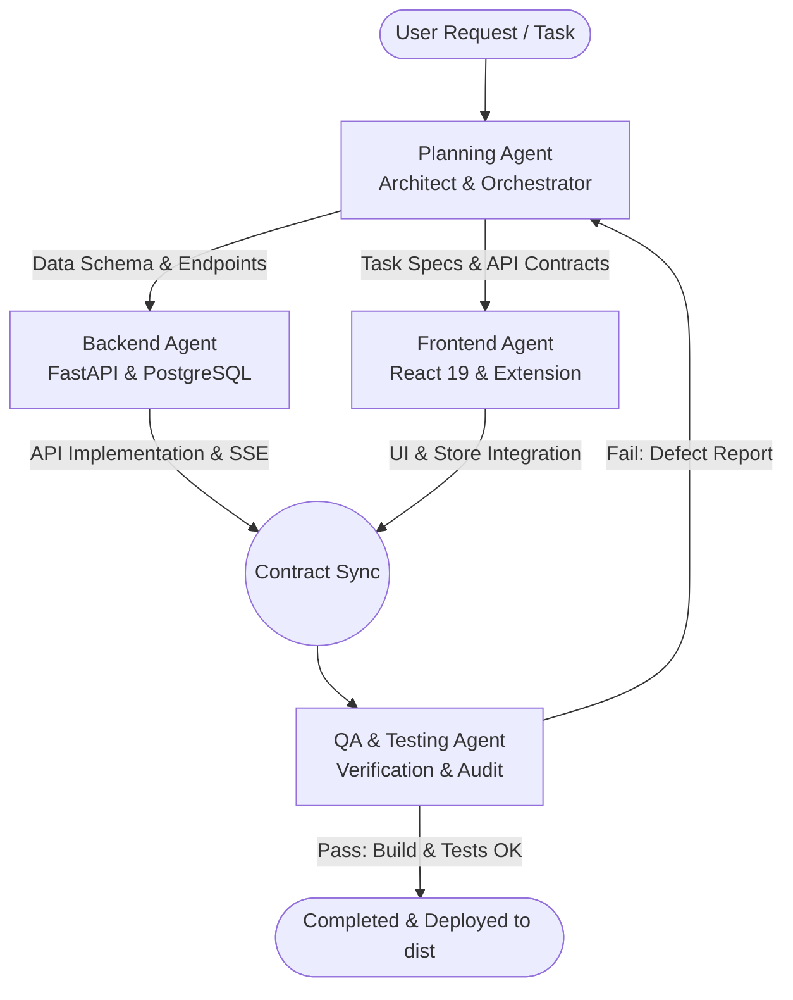
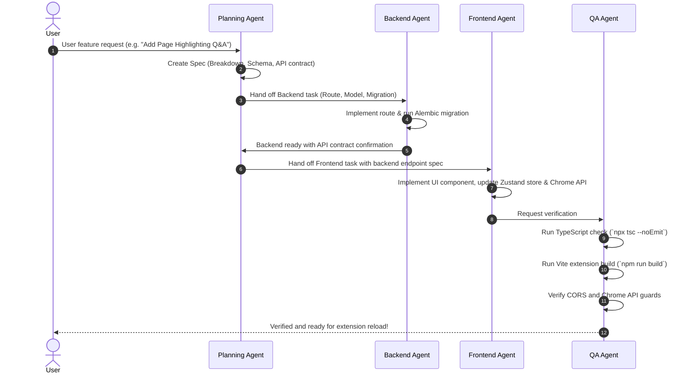
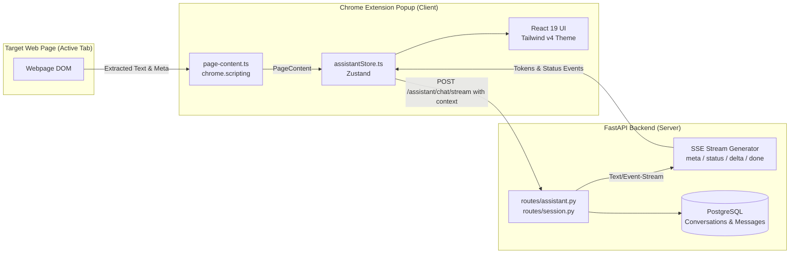

# AI Page Assistant - Multi-Agent Architecture

This document describes the multi-agent architecture governing the development, maintenance, and expansion of the **AI Page Assistant** system.

---

## 1. Multi-Agent Hierarchy & Workflow

---

## 2. Agent Roles and Boundaries

| Agent | Scope & Ownership | Primary Tools & Tech | Key Deliverables |
| :--- | :--- | :--- | :--- |
| **Planning Agent** | Architecture, task breakdown, API schemas, dependency sequencing | Markdown, System Design, Contract Drafting | Action plans, OpenAPI/SSE schemas, Task tickets |
| **Frontend Agent** | Chrome Extension UI, components, state, Chrome APIs | React 19, TypeScript, Tailwind v4, Zustand, Vite | Extension views, store, page scraper, CSS |
| **Backend Agent** | API endpoints, DB models, migrations, streaming, AI integration | FastAPI, SQLAlchemy 2.0, Alembic, PostgreSQL, SSE | Endpoints, models, migrations, LLM streaming |
| **QA & Testing Agent** | Type safety, build verification, extension packaging, CORS | `tsc`, Vite Build, Pytest, Lint, Chrome inspect | Audit reports, test validations, build checks |

---

## 3. Communication Protocol Between Agents

---

## 4. System Data Flow (Runtime Architecture)

---

## 5. Decision Rules
* **Frontend cannot invent unannounced API endpoints**: Must refer to backend routes registered in `server/app/main.py`.
* **Backend cannot alter SSE event structure** (`meta`, `status`, `delta`, `done`, `error`) without approval from the Planning Agent.
* **QA Agent has veto power**: If `npm run build` or `npx tsc` fails, the task cannot be marked done until fixed.
